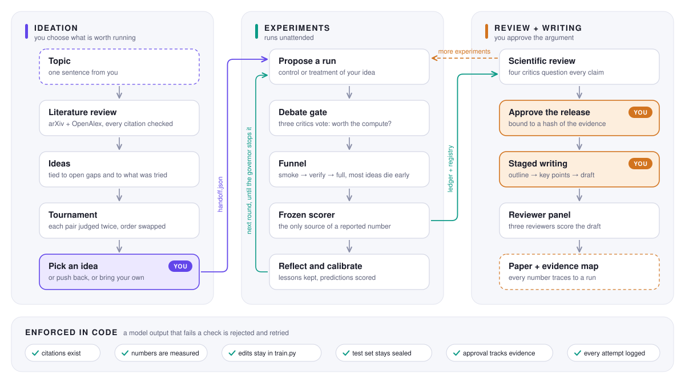

<div align="center">

# 🔬 Scholar Loop

**A research loop that shows its work.**

Literature review → ideas → real experiments → scientific review → a paper,<br>
with you at the two decisions that matter and code checking everything that can be checked.

[](https://github.com/renee-jia/scholar-loop/actions/workflows/ci.yml)
[](#-try-it-in-a-minute)
[](LICENSE)
[](#-limits)

[Try it](#-try-it-in-a-minute) · [How it works](#-how-it-works) · [The rules](#%EF%B8%8F-rules-the-model-cannot-talk-its-way-around) · [Results](#-what-we-have-measured) · [Limits](#-limits) · [Reference](#-reference)

<br>

<picture>
  <source media="(prefers-color-scheme: dark)" srcset="assets/workflow-dark.svg">
  
</picture>

</div>

## What this is

Ask a language model to "do research" and you get a confident paper. The trouble starts when
you check it: a citation that does not exist, a number nobody measured, a headline idea that
was never actually run.

ScholarLoop is built around that problem. The model still does the thinking: it reads papers,
proposes ideas, designs experiments and writes. But it works inside a harness that keeps the
books. Every run goes into an append-only ledger. Every number in the paper has to match a
measurement from a scorer the model cannot touch. Every citation has to be a paper that was
actually retrieved. When an output breaks a rule, the harness rejects it, hands the errors
back, and the model tries again.

You make two calls yourself: which idea is worth running, and whether the evidence supports
the argument before any prose is written.

> [!IMPORTANT]
> ScholarLoop does not claim to be a better scientist or a better optimizer. Against random
> search on a five-knob problem, the agent loses or ties ([numbers below](#-what-we-have-measured)).
> What it offers is a research process you can audit line by line.

## 🚀 Try it in a minute

The demos need no GPU and no API key. A scripted model stands in for the real one.

```bash
pip install -e ".[dev]"
python examples/quickstart.py          # one idea climbs smoke → verify → full
python examples/ideation_demo.py       # review → your feedback → ideas → you pick → it runs
python examples/writing_demo.py        # outline → panel debate → you approve → prose → review
```

```text
baseline to beat: 4.9% val_top1_err

  smoke  val_top1_err=3.7644%  [kept]
  verify val_top1_err=3.8004%  [kept]
  full   val_top1_err=3.8208%  [kept]
```

Real training, still free:

```bash
pip install -e ".[dev,engines]"        # torch + scikit-learn
python examples/campaign_demo.py       # the full agent chain on real torch runs
python examples/governed_campaign.py   # parallel funnel that decides when to stop
pytest -q
```

For live runs, add `".[llm]"` and set `ANTHROPIC_API_KEY`.

## 🧭 How it works

### 1 · Ideation: you say where to dig, then choose what is worth running

```bash
python -m scholarloop.ideation --profile profiles/digits-mlp.yaml \
    --topic "regularization recipes for small MLPs" --out runs/s1
#   What do you want to find out, and why does it matter to you?
#   > whether dropout or weight decay is doing the work on a tiny MLP, and why
#   Hunches or mechanisms you want tested
#   > most of the dropout gain is the model peaking later, not regularization
#   (a)pprove · (r)efine <feedback> · (q)uit  >  r also cover data-side regularization such as mixup
#   (c)hoose <n,n> [| note] · (o)wn <your direction> · (r)emap <feedback> >  c 1,3 | one knob per idea
#   (s)elect <n> · (r)efine <feedback> · (q)uit >  s 2
```

Nothing is generated from a bare topic. ScholarLoop first asks for your steer: what you want to
find out, the hunches you want tested, what to stay away from, what you already know. The steer
shapes the search queries, and ideation refuses to start without it.

It then plans queries, pulls papers from arXiv and OpenAlex, and writes a review with themes,
per-paper notes and open gaps. Read it and push back if something is missing.

Between the review and the ideas sits a direction map (`directions.md`): three to five lines of
inquiry, each tied to reviewed papers, with an open question, a cheap first experiment and the
most likely way it turns out dull. Every hunch you gave must be addressed, and the map is not
allowed to only agree with you: at least one direction has to challenge a hunch or come from
outside your steer. You choose directions, or write your own. Ideas are generated only inside
the directions you chose, and each one says which direction it belongs to and what you would
learn from it.

The model does not get to rank its own ideas. A panel of judges compares every pair twice, with
the order swapped. A win in only one order counts as a draw, which cancels the bias toward
whichever idea is shown first. Elo is computed in code and the full match log is saved.

You pick one, or reject them all, or write your own with `--inject-idea`. The choice is saved to
`handoff.json`.

<details>
<summary>Scripted and deeper modes</summary>

`--steer examples/steer.json` (or `--interest "…" --hunch "…" --avoid "…"`) gives the steer
without a terminal. The run then stops at the direction map; `--directions 1,3`,
`--own-direction "…"` and `--direction-note "…"` record your choice and continue.
`--stop-after review|directions|ideas` writes that page and exits for a human. `--feedback "…"`
and `--select 2` resume from another process. `--auto` chooses every mapped direction and the
tournament's top idea; `--unsteered` waives the steer. Both are logged as not being your call.
`--deep --brief examples/research_brief.json` generates ideas by independent strategies
(mechanism, transfer, contradiction) with retrieval per idea.
`--decision reject|refine|merge|revive --idea-ids …` records your decisions against stable
idea IDs. `python -m scholarloop.ideation.pilot` runs a small validation-only pilot across
several ideas before you commit to one.

A meta-reviewer turns the judges' recurring complaints into at most five recommendations. Each
must cite the matches that show it, and the next round of ideas is written against them.

</details>

### 2 · Experiments: the idea you picked gets tested

```bash
SCHOLARLOOP_HANDOFF=runs/s1/handoff.json SCHOLARLOOP_OUT=runs/s1 \
    python examples/run_to_paper.py
```

This part runs on its own. Each round, the Reasoner proposes runs, three critics vote on
whether each one deserves compute, and the survivors climb a funnel: one seed, then three, then
five. Most ideas die after the first cheap run.

Four things keep it honest:

- **Your idea cannot be tuned around.** Every proposal says whether it applies the idea
  (`treatment`) or is the matched run without it (`control`). The harness allows one control
  before the first treatment and will not let the loop change direction until a treatment has
  run. If no hyperparameter expresses the idea, the Reasoner rewrites the training script, and
  that edit runs in an isolated copy.
- **The model never reports its own score.** The training script trains and saves weights.
  A separate, frozen scorer produces the number.
- **Predictions are checked.** Each proposal predicts its effect before it runs. The loop
  scores those predictions and shows each agent its track record.
- **The test set stays sealed.** Exploration only sees validation data. Opening the held-out
  split takes an explicit request and ends exploration for that campaign.

### 3 · Review and writing: you approve the argument

```bash
python -m scholarloop.review review  --profile profiles/digits-mlp.yaml \
    --ledger runs/s1/experiments.jsonl --registry runs/s1/registry --research runs/s1 --out runs/s1
python -m scholarloop.review approve --profile profiles/digits-mlp.yaml \
    --ledger runs/s1/experiments.jsonl --registry runs/s1/registry --research runs/s1 --out runs/s1 \
    --author Researcher --review-hash EXACT_REVIEW_HASH
python -m scholarloop.writing --profile profiles/digits-mlp.yaml \
    --ledger runs/s1/experiments.jsonl --registry runs/s1/registry --research runs/s1 --out runs/s1
```

Before any prose exists, four critics go through the evidence claim by claim. If they want a
control or an ablation, `python -m scholarloop.experiment.agenda` freezes it as a protocol,
runs every condition, and keeps the negative results. Then the critics look again.

Nothing gets written until you approve the review, and your approval is tied to a hash of the
evidence. Change a run, the argument or the code afterwards and the approval is void.

Writing then happens in three passes. A Skeptic, an Editor and a Methodologist argue over the
outline until they accept it, and you sign off. The same happens for the key points. Only then
is each section drafted, from points everyone already agreed on. A final panel of three
reviewers scores the draft.

## 🛡️ Rules the model cannot talk its way around

These live in code. A prompt can ask for good behaviour; a check can refuse the output.

| Rule | What gets rejected |
|---|---|
| Citations must exist | a paper id that is not in the retrieved corpus, anywhere from the review to the final prose |
| Numbers must be measured | a number no measurement supports. In reviewed writing, each sentence cites an approved statement and its numbers must come from that statement |
| Evidence must exist | an unknown run or statement id; a result claim with no evidence behind it |
| Scores come from the frozen scorer | a metric from anywhere else; an edit outside the training script; a scorer file that changed mid-run |
| The idea gets tested | a second control before the first treatment |
| The test set stays sealed | scoring it during exploration; exploring after it was opened |
| Approval follows the evidence | writing against a review whose evidence, argument or code has changed |
| Rankings must be robust | a tournament win that holds in only one order; a recommendation no match supports |
| Prose stays plain | em-dashes, "not X, but Y", stacked connectives, hype phrases |
| Budgets hold | requests past a call cap, training runs past a reservation, spend past a dollar cap |

Every attempt by every agent is logged with its output, its validation errors and its outcome,
so the rejected attempts stay on the record too.

## 📊 What we have measured

<table>
<tr>
<td align="center" width="33%"><h3>3.33%</h3>held-out error in the live digits run<br><sub>baseline 3.8% · and the paper was still rejected</sub></td>
<td align="center" width="33%"><h3>0 of 9</h3>campaign pairs where the agent beat random search<br><sub>before a warm start made it a tie</sub></td>
<td align="center" width="33%"><h3>97% · 0%</h3>of injected fabrications and misattributions caught<br><sub>617 faults, no false alarms on 14 clean artifacts</sub></td>
</tr>
</table>

### A full live run, and why its own reviewers rejected it

[`examples/sample_runs/digits`](examples/sample_runs/digits/) is a verbatim capture of one
complete run with `claude-opus-5-5`: a literature review, five ideas, a tournament pick, 18 real
training runs, a staged write-up and a review. It cost about $0.94 for the campaign and $5.53
for the write-up.

The result beat the baseline, 3.33% held-out error against 3.8%. The reviewer panel gave it
2.2 out of 10 anyway, and they were right. The tournament had picked an augmentation idea, the
campaign only tuned hyperparameters, and so the paper's own hypothesis was never tested. The
run also showed that the funnel's tiers were being compared on different validation folds.

Both are fixed now. That failure is where the treatment-versus-control rule comes from. The
capture's [README](examples/sample_runs/digits/README.md) lists everything else the run exposed.

### Agent versus random search

Same number of training runs for each side, three campaigns each, on digits
(`examples/compare_search.py`):

| Agent | Agent held-out error | Random search | Result |
|---|---|---|---|
| first version | 4.22 (only 1 of 3 campaigns finished the funnel) | 3.13 ± 0.08 | random wins |
| told the knob ranges, with an explore phase | 3.72 ± 0.24 | 3.13 | random wins all 9 pairs |
| warm-started on random draws | 3.14 | 3.13 | a tie, and every agent best was one of the random draws |

A language model proposing hyperparameters does not beat random search on a small search
space. If it has an edge, it is in changing the method, which is what the edit channel and the
treatment rule are for. We have not yet shown that it does.

### Do the checks actually catch things?

`scholarloop.reliability` tests the guards directly. It takes artifacts the guards accepted,
changes one thing at a time, and runs each variant through the production check. On the digits
run:

| Kind of fault | Example | Caught |
|---|---|---|
| Fabrication | a citation, run id or number that does not exist; a required section removed | 276 of 284 (97%) |
| Misattribution | a real citation or measurement used in the wrong place; "lower" flipped to "higher" | 0 of 333 (0%) |

The zero is the important number. A check that looks up whether something exists cannot tell
whether it is used correctly. That run predates reviewed writing, which binds each sentence's
numbers to the statements it cites; the study now runs in that mode on newer runs.

The study also found a real hole. Identifiers written inline in the outline and key points
were not being checked, only the evidence lists. Closing it took fabrication detection from 88%
to 97%. The remaining misses are numbers in the outline, which can be derived quantities such
as differences and so cannot be looked up.

```bash
python -m scholarloop.reliability inject   --profile profiles/digits-mlp.yaml --run runs/s1 --out runs/s1/reliability
python -m scholarloop.reliability traces   --traces runs/s1 --out runs/s1/reliability
python -m scholarloop.reliability baseline --profile profiles/digits-mlp.yaml --run runs/s1 \
    --out runs/s1/reliability --repeats 3      # uses the API
```

`traces` counts how often a first attempt was rejected in a real run, which is what would have
gone through with the checks off. `baseline` has one model call write the whole paper with the
rules stated in the prompt only, then audits it with the same checkers.

## 🧪 Engines

A domain is a YAML profile plus two files: a frozen `prepare.py` that owns the data, the model
definition and the scorer, and a `train.py` the agent may rewrite. Adding a domain does not
touch the orchestrator.

| Profile | Task | Notes |
|---|---|---|
| `digits-mlp` | 8x8 digit classification, MLP | no download · 1-2 s per run on CPU · 5-fold validation + held-out test |
| `agnews-bow` | AG News topic classification, bag of embeddings | fixed 10,000-article subset · about 1 s per run · one-time download (`".[nlp]"`) |
| `image-classification` | deterministic stub | powers the free demos and the tests |
| `cheater` | a training script that tries to fake its score | the adversarial fixture for the scoring tests |

### An NLP case study under a spend cap

```bash
export ANTHROPIC_API_KEY=sk-ant-...
pip install -e ".[dev,engines,llm,nlp]"
bash examples/case_study_agnews.sh        # uses the API · stops at CAP=10 dollars by default
```

One script runs the whole flow on AG News in one directory, and every stage resumes from where
it stopped. Run it in a terminal, because the review and the writing wait for you. The task was
chosen because it has something to argue about: word dropout lowers error by about a point at
the default training length, and so does simply stopping earlier. A captured run is not
published yet.

## 💸 Keeping spend under control

| Control | What it does |
|---|---|
| `SCHOLARLOOP_SPEND_CAP` + `SCHOLARLOOP_SPEND_FILE` | a hard dollar cap shared by every command that points at the same file. Checked before each request, so the most it can overshoot is the request in flight |
| `--max-llm-calls`, `--max-calls` | a cap on model requests that survives restarts and counts retries |
| `SCHOLARLOOP_MAX_COST` | a softer threshold checked between rounds and stages |
| training reservations | a cap on training attempts. Failed attempts still count |

Spend is estimated from token counts and a price table. With a dollar cap set, a model that has
no listed price is refused.

## 🗂️ What is in the repo

```text
scholarloop/
├── core/            agent harness, model clients, profiles, ledger, registry, budgets
├── ideation/        retrieval, literature review, steer and direction map, ideator, tournament, meta-review
├── experiment/      orchestrator, runner, reasoner, debate, advisor, reflector, governor,
│                    experiment agenda, research cycle, comparisons
├── review/          evidence dossier, critics, issue history, author release
├── writing/         staged writing session, one-shot fallback, writing guides
├── reliability.py   fault injection, attempt-log analysis, single-call baseline
└── evaluation.py    read-only run diagnostics
engines/             prepare.py (frozen) + train.py (editable) per domain
profiles/            domain profiles
examples/            demos, the live flow, the case-study script, a captured run
assets/              the workflow diagram and the script that draws it
tests/               mirrors the package and runs offline
```

Command-line entry points, each with `--help`: `python -m scholarloop.ideation`, `.review`,
`.writing`, `.reliability`, `.evaluation`, `.experiment.agenda`, `.experiment.research_cycle`,
`.experiment.suite`, `.experiment.decision_bench`, `.experiment.decision_policy`,
`.ideation.pilot`.

## 📌 Limits

This is a research preview. It runs end to end on real experiments and has been run live, but
several things are missing or unproven.

- **It has not been shown to produce better research.** The mechanisms are tested as software.
  Whether they improve research quality needs a matched-budget study with expert judges.
- **There is no real sandbox yet.** A hash detects a tampered scorer, but nothing stops
  a process from writing to disk, and splits over public data can be reconstructed. The guards
  are designed for a model proposing edits, not for hostile code. Container isolation is not
  implemented.
- **Wrong-but-real references get through the lexical checks.** Catching a real citation on the
  wrong claim falls to the critics and the semantic reviewer, and those are model judgments.
- **"Treatment" is a label the agent applies.** The harness enforces the order of control and
  treatment and records the edit for review. It does not verify that the edit implements the idea.
- **Novelty checks are provisional.** They compare against retrieved abstracts.
- **One model provider.** Live runs go through the Anthropic SDK. Other providers need a small
  client class.
- **Small tasks only.** The shipped domains train in seconds on a CPU.

## 📖 Reference

<details>
<summary><b>Candidates, snapshots and what the Reasoner sees</b></summary>

The Reasoner and Director receive a bounded validation evidence view: configurations, scores,
seed/fold identities, failures and the frontier. It excludes held-out scores and scientific
control runs. Observed losing regions are soft warnings, not causal exclusions; repeated
fidelity tiers count once per candidate when deriving these associations.

Each new run records a `candidate_id` and a separate `run_spec`. Candidate snapshots in
`registry/candidates/` bind the requested configuration, local engine Python sources, frozen
scorer and declared execution context. Different implementations remain distinct even at
identical knobs; changing seed or fidelity creates a different run of the same candidate. The
Reasoner sees the frontier's source and inherits its code and requested knobs by default,
including after restarting a campaign. `base: "root"` explicitly starts from repository code and
profile defaults. Changing scorer or dependencies requires a new root candidate. Legacy runs
without snapshots remain readable but cannot supply inherited implementations.

Scientific review includes these snapshots and rejects missing or modified candidate files. They
document execution inputs; they do not certify undeclared data, external dependencies or
scientific validity. Frontier selection and convergence tracking use a common fidelity and
seed/fold scope, and prediction calibration uses matched reference observations when available.
The funnel's SEM margin is a resource-allocation heuristic, not a significance test.

Loop components: `Orchestrator.population_step(k, max_workers)` (parallel population funnel),
`Governor(max_cost, max_rounds, dry_patience)` (self-stopping), `CalibrationLog`
(predict-then-verify), `SkillLibrary.render(query=…)` (relevance-ranked, time-decaying lessons).

</details>

<details>
<summary><b>Scientific review, releases and the experiment agenda</b></summary>

Optional `--critic-model ROLE=MODEL` mappings choose different reviewer models; every critic
must answer evidence questions for each claim. `--max-llm-calls` caps cumulative CLI requests,
including retries, rather than dollars. Old v1 releases require re-review under the v2 contract.
Changed evidence, code, declared data or research scope invalidates a release. An existing
writing session bound to an older release needs a new output directory and `--review-dir`.

For `NEEDS_EXPERIMENTS`, use `python -m scholarloop.experiment.agenda plan` with the same
profile, ledger, registry, research and out arguments. Inspect the frozen protocol, then use
`run` with `--protocol-hash HASH --author Researcher` and re-run scientific review.

Use `SCHOLARLOOP_RESUME=1` to continue a campaign containing frozen protocols; fresh mode
refuses to erase that evidence. Protocol hashes detect changed inputs, not hostile execution.
`run_to_paper.py` pauses for the author's decision, including in unattended mode;
`SCHOLARLOOP_WRITING=oneshot` keeps the single-call writer behind the same gate.

In reviewed writing, claim dependencies and evidence IDs are validated, and a separate semantic
reviewer checks attribution, scope and mandatory limitations. A drafted section that drops one
of its agreed key points is flagged in the draft's notes.

</details>

<details>
<summary><b>Final-test controls and attempt logs</b></summary>

Final-test access closes that campaign to new exploration and experiment plans, including when
test scoring fails. A previously frozen confirmation protocol may finish its planned conditions;
review and writing may still inspect its results. This is a ledger-level guard, not OS isolation
or proof that a reused dataset is statistically independent. Historical campaigns containing
test results are also closed to further exploration.

Before a confirmation run starts, the runner persists and fsyncs a test-access receipt beside
its ledger in `<ledger>.test-access/`. Keep this directory with the ledger when moving a
campaign. An incomplete receipt or a receipt without its matching ledger result closes execution
and blocks scientific review; an interrupted run is never automatically replayed. Completed
receipts are part of the review snapshot and permit the original protocol to continue. Recovery
requires inspecting the run and reconciling its real evidence; deleting a receipt or restarting
with the same test data does not restore statistical independence.

Confirmation continuation is validated at the public runner boundary: a claimed protocol must
exist under its content hash and match the frozen context, condition, effective code and config,
seeds, fidelity and test-access setting. Each condition has one canonical run ID. Reusing a
protocol string cannot authorize another candidate or a repeat; exploration artifact caches
cannot be supplied to protocol confirmation runs. A standalone explicit confirmation without a
protocol remains a single access that closes its campaign.

Agent attempts are persisted as `*.agents.jsonl` by experiment, ideation, review and writing
sessions. Each attempt has a durable start event, input and schema fingerprints, model identity,
and a finish event containing the structured output, validation errors, status and elapsed time.
Raw prompts are not stored. An unmatched start denotes an unfinished attempt; provider errors
and invalid JSON remain visible. Client usage snapshots are cumulative and must not be treated
as per-attempt costs when requests share a client. `python -m scholarloop.evaluation` reports
these logs, including corrupt tails.

</details>

<details>
<summary><b>Search comparisons and multi-task suites</b></summary>

Search comparisons freeze declared profile and engine inputs and settings in
`comparison_plan.json`; resuming with different settings is rejected. Interrupted campaign
directories are preserved, failed campaigns are recorded, and budget-skipped repeats remain in
the reported denominator. Score intervals describe observed outcomes only. Run-matched campaigns
reserve each training attempt before dispatch and never exceed their configured count. Failed
and interrupted attempts remain charged; cached models do not consume a new reservation.
Accounting is persisted beside the ledger as `*.training_budget.json`. This caps training
attempts, not GPU seconds or financial cost. `compare_search.py --max-calls` caps model requests
persistently across retries and repeats (default 100); `--max-cost` is an estimated stop
threshold between campaigns. Unknown prices block cost-limited campaigns.

For multiple tasks, use `python -m scholarloop.experiment.suite --manifest suite.json --out runs/suite`.
The manifest has `version: 1` and a `tasks` array. Every task supplies `id`, `split`
(`development` or `evaluation`), `dataset_group`, `profile`, `seeds` and `train_budget`. Profile
paths are relative to the manifest. Both partitions are required; shared dataset groups or
profile dataset names across partitions are rejected. The suite freezes its declared inputs,
retains every planned repeat, and keeps per-task metrics separate. The CLI runs the
random-search baseline without API calls. Programmatic model arms must provide an orchestrator
with a persistent `CallLimitedLLM` budget. Dataset declarations and disjoint labels do not
establish real-world independence.

</details>

<details>
<summary><b>Research iterations after preliminary results</b></summary>

`ResearchCycle` separates scientific progress from parameter-search progress. Each assessment
reads the complete current dossier (including failures and negative results) and the latest five
iteration records, with older records retained on disk and an explicit omission count. It asks
whether the evidence is insufficient, promising within scope, or contradictory within scope;
these are provisional model assessments, not verified scientific conclusions.

A stable issue register is reconstructed from all rounds and supplied independently of the
five-round history window. Every assessment must update every tracked concern exactly once.
Proposing `addressed_pending_review` requires an existing dossier evidence ID absent when the
issue opened, plus a rationale. This checks provenance, not whether evidence logically resolves
the concern: addressed proposals remain visible and still require scientific review. Reworded
concerns remain separate rather than silently merging away uncertainty.

The next-step recommendation must name the primary and competing explanations, a discriminating
comparison, contrasting predictions, a falsifying outcome, claim limits and a training budget.
When issues already exist, an experimental recommendation must reference at least one tracked
issue ID and select a named competing explanation. It must state prospective decisions for
primary-supporting, alternative-supporting and inconclusive outcomes, along with what the
experiment cannot resolve. These fields accompany the recommendation into critic review and the
experiment planner; the review hash and frozen protocol include the original recommendation.
Critic requests take precedence over the provisional recommendation.

Iteration-derived protocols additionally require a `discrimination` mapping: reference and
treatment names, the reviewed competing explanation, why the contrast is informative, controlled
factors, residual confounds, inconclusive outcomes and departures from the recommendation.
Identical executable configurations for an ablation, falsification or boundary test are
rejected. This is a structural check, not a causal certificate.

Each reassessment must appraise every protocol in the current dossier, citing its protocol ID
and contrasting observations with the frozen predictions. Missing derived analysis requires
`execution_incomplete`; incomplete comparisons cannot favor either explanation. Actions include
debugging, replication, ablation, falsification, boundary tests, pivoting and stopping.
Recommendations cannot execute experiments, issue author approval or open the final test.

```bash
python -m scholarloop.experiment.research_cycle \
  --profile profiles/digits-mlp.yaml --ledger runs/study/experiments.jsonl \
  --registry runs/study/registry --out runs/study \
  --question "Does the mechanism explain the validation improvement?" \
  --max-training-attempts 12

python -m scholarloop.review review \
  --profile profiles/digits-mlp.yaml --ledger runs/study/experiments.jsonl \
  --registry runs/study/registry --out runs/study \
  --iteration runs/study/research_iterations.json
```

Review rejects a recommendation if its evidence snapshot is stale. Accepted experimental
requests proceed through the experiment agenda: freeze the protocol, execute its conditions,
reassess the new evidence, and review again. This closes a research iteration path; it does not
establish that the policy improves itself.

Pairwise ideation ranking receives bounded retrieved abstracts, provisional novelty comparisons,
the research brief and prior dissent. Position-swapped judgments and omission markers remain
explicit, and match records bind the evidence context by hash.

</details>

<details>
<summary><b>Controlled research-decision development harness</b></summary>

A free synthetic harness (no model, no training) for developing evaluations of research
decisions:

```bash
python -m scholarloop.experiment.decision_bench \
  --out runs/decision-development --repeats 3 --seed 0 --budget 3
```

Four single-cause task families share similar preliminary gains: leakage, extra compute,
population-specific effects, and gains that survive the three available controls. Policies
receive a public task plus their observed intervention results. The evaluator holds the truth
and scores decisions without a model as judge. Budget units are synthetic intervention costs.
The runner compares accept-all, abstain-all, fixed-order and random-order controls on the same
tasks and budget. `plan.json` freezes task generation, actions, budget, arms and implementation
hash; `report.json` retains every episode, failure, observation and decision. Failed and
exhausted episodes remain in the accuracy denominator.

This is an evaluator development fixture, not evidence that ScholarLoop improves research. The
full `ResearchCycle` is not yet a benchmark arm. Trusted in-process policies have only an
API-level information boundary. Reports contain truth labels and must not be fed back into an
agent evaluated on the same tasks.

**Model-policy ablation (uses the API, not part of tests):**

```bash
python -m scholarloop.experiment.decision_policy \
  --out runs/decision-model-development --model YOUR_MODEL_ID \
  --repeats 3 --budget 3 --max-calls 8
```

`plain` and `structured` policies use the same model, response schema, budget and per-episode
request cap; only their system instructions differ. `--max-calls` applies separately to each
task and arm, including schema-repair retries: three repeats, four families and two arms reserve
at most 192 requests. Prompts, schema, model, implementation and evaluator hashes are frozen with
the plan. Completed episodes are reused; an episode started without a saved result is retained
as interrupted and never silently rerun.

Add `--arms plain,structured,iteration` to include a stateful component arm that reuses the
production `IterationReviewer` validation and cross-round issue replay on explicitly marked
synthetic evidence. It evaluates the reviewer and state component, not the entire research
cycle, critic panel, frozen-protocol execution or manuscript workflow. With three arms the
maximum is 288 requests. No paid model comparison has been performed.

</details>

<details>
<summary><b>Environment variables for <code>examples/run_to_paper.py</code></b></summary>

| Variable | Meaning |
|---|---|
| `SCHOLARLOOP_OUT` | output directory (default `runs/live`) |
| `SCHOLARLOOP_PROFILE` | `profiles/<name>.yaml` (default `digits-mlp`) |
| `SCHOLARLOOP_MODEL` | model id (default `claude-opus-5-5`) |
| `SCHOLARLOOP_HANDOFF` | a research session's `handoff.json`; the campaign adopts its idea |
| `SCHOLARLOOP_STEPS`, `SCHOLARLOOP_POPULATION`, `SCHOLARLOOP_MAX_WORKERS` | rounds, ideas per round, parallel smoke runs |
| `SCHOLARLOOP_DRY_PATIENCE` | stop after this many rounds without a frontier improvement |
| `SCHOLARLOOP_MAX_COST` | estimated dollar threshold, checked between rounds and stages |
| `SCHOLARLOOP_WRITING` | `session` (interactive on a terminal), `auto`, or `oneshot` |
| `SCHOLARLOOP_PAPER_ONLY` | skip the campaign and write up the saved ledger |
| `SCHOLARLOOP_RESUME` | continue the saved campaign |
| `SCHOLARLOOP_PERSIST_SKILLS` | keep lessons in `~/.scholarloop/skills/<domain>` across campaigns |

</details>

## License

[MIT](LICENSE).
