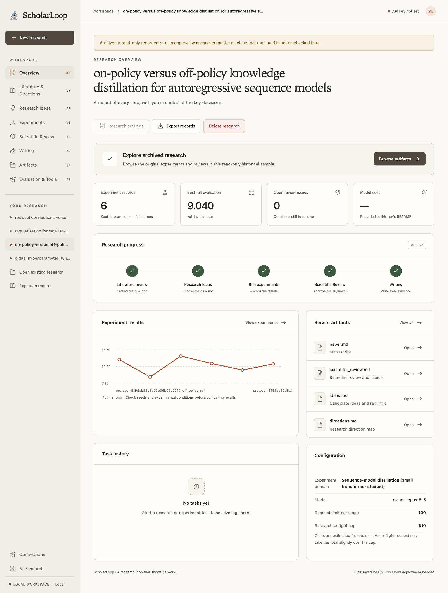
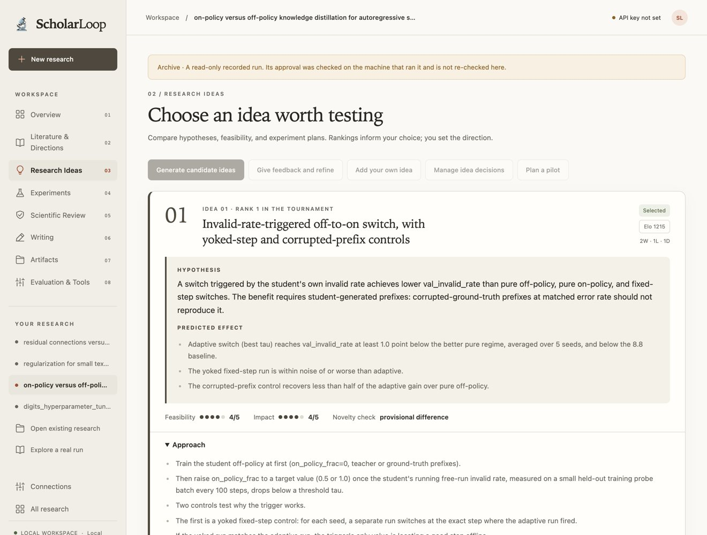
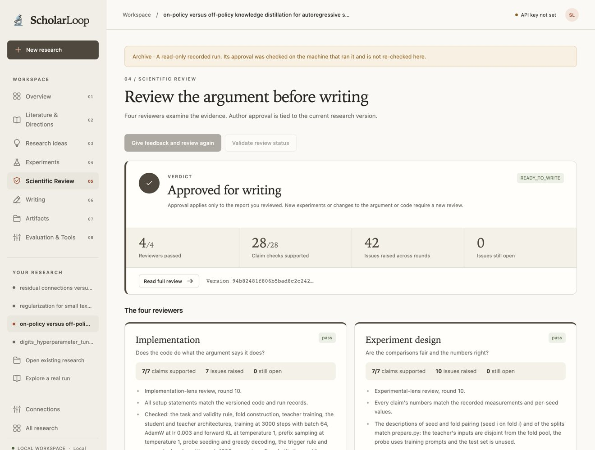
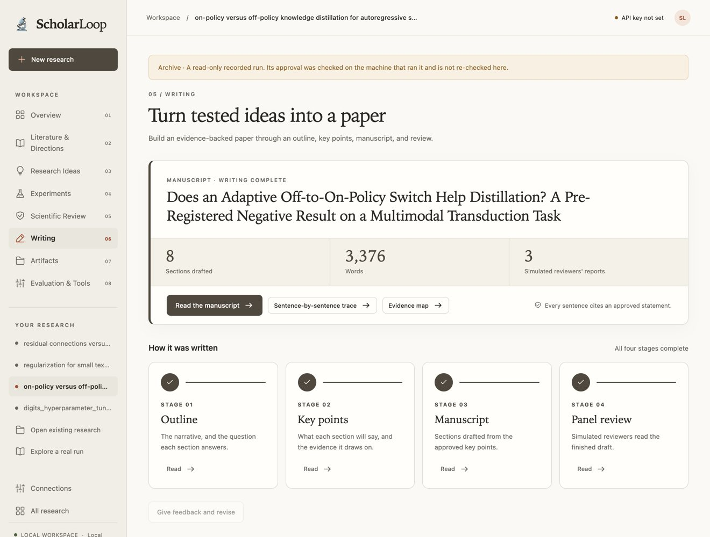

<div align="center">

# 🔬 ScholarLoop

**A research loop that shows its work.**

You steer. The model reads, proposes, experiments and writes.<br>
Code checks every citation, number and claim against the record before it reaches the page.

[](https://github.com/renee-jia/scholar-loop/actions/workflows/ci.yml)
[](#-quick-start)
[](#-quick-start)
[](LICENSE)
[](#-limits)

[Quick start](#-quick-start) · [The web UI](#%EF%B8%8F-the-web-ui) · [What it does](#-what-it-does) · [How it works](#-how-it-works) · [The rules](#%EF%B8%8F-rules-the-model-cannot-talk-its-way-around) · [Results](#-what-we-have-measured) · [Limits](#-limits)

<br>

<picture>
  <source media="(prefers-color-scheme: dark)" srcset="assets/workflow-dark.svg">
  
</picture>

</div>

## Why

Ask a language model to "do research" and you get a confident paper. The trouble starts when you
check it: a citation that does not exist, a number nobody measured, a headline idea that was
never actually run.

ScholarLoop keeps the model doing the thinking and puts a harness around it that keeps the
books. When an output breaks a rule, the harness rejects it, hands the errors back, and the
model tries again. You stay at the decisions that need judgment.

> [!IMPORTANT]
> ScholarLoop does not claim to be a better scientist. Its own reviewers rejected every paper
> it has written, and on hyperparameter search it ties or loses to random search. What it offers
> is a research process you can audit sentence by sentence, and [measurements](#-what-we-have-measured)
> of how often that audit holds.

## ✨ What it does

<table>
<tr>
<td width="50%" valign="top">

**🧭 Ideation you steer**

It will not start from a bare topic. You say what you want to find out and your hunch; it maps
directions from the literature, and at least one must challenge you.

</td>
<td width="50%" valign="top">

**🧪 Ideas that actually get tested**

The idea you pick has to run as a treatment against a matched control. The loop cannot wander
off and tune hyperparameters instead.

</td>
</tr>
<tr>
<td valign="top">

**🔒 Scores the model cannot touch**

Training only saves weights. A separate, frozen scorer produces every reported number, and the
held-out split stays sealed during exploration.

</td>
<td valign="top">

**⚖️ Review before prose**

Four critics question every claim against the measurements. They can demand a control, which is
frozen as a protocol before it runs. Nothing is written until you approve.

</td>
</tr>
<tr>
<td valign="top">

**🔗 Every sentence traceable**

Each sentence of the paper cites an approved statement, each statement its runs, each run its
code version. Change the evidence and your approval is void.

</td>
<td valign="top">

**🖥️ A web UI, under a hard budget**

Run every stage from a local web UI or the command line. A dollar cap is checked before each
model request, and the UI tells you which tools are free to run.

</td>
</tr>
</table>

## 🚀 Quick start

```bash
git clone https://github.com/renee-jia/scholar-loop.git && cd scholar-loop
pip install -e ".[dev]"
python3 -m scholarloop.ui            # Windows: python -m scholarloop.ui
```

Your browser opens on `http://127.0.0.1:8765`. Click **Explore a real run** to walk through four
[recorded runs](examples/sample_runs/), from the author's steer to the reviewed paper and the
evidence behind each sentence. No API key, no GPU.

| I want to… | Run | Costs |
|---|---|---|
| browse finished research | `python3 -m scholarloop.ui`, then **Explore a real run** | free |
| watch the loop on a scripted model | `python examples/quickstart.py` · `ideation_demo.py` · `writing_demo.py` | free |
| run real torch training, scripted model | `pip install -e ".[dev,engines]"`, then `python examples/campaign_demo.py` | free |
| do live research | `pip install -e ".[dev,engines,llm]"`, add your Anthropic key under **Connections** in the UI | API spend, capped |

Every script is listed in [`examples/README.md`](examples/README.md). `pytest -q` runs the
offline tests.

## 🖥️ The web UI

The UI runs on your machine only. It starts the same stage commands as the command line, keeps
their logs, and takes each of your decisions as an explicit action. A recorded run opens
read-only, so you can look at everything without spending anything.



<table>
<tr>
<td width="33%" valign="top"><br><b>Ideas.</b> Each one leads with its hypothesis, next to its tournament standing, scores and linked sources.</td>
<td width="33%" valign="top"><br><b>Review.</b> The verdict and the counts behind it, then the four critics and every issue they raised.</td>
<td width="33%" valign="top"><br><b>Writing.</b> The manuscript, its sentence-by-sentence trace and evidence map, and the four stages that built it.</td>
</tr>
</table>

| Page | What you find there |
|---|---|
| Literature & Directions | your steer, the literature review, and the direction map with each direction's open question |
| Research Ideas | the candidate ideas, their tournament, and the one you picked |
| Experiments | every run with its stage, role and score, and one bar per fully evaluated arm |
| Scientific Review | the verdict, each critic's summary, and the issues grouped by state and severity |
| Writing | the manuscript and what each writing stage produced |
| Artifacts | every file of the run, grouped by the stage that wrote it |
| Evaluation & Tools | diagnostics and reliability checks, split into free ones and ones that call the model |

## 🧭 How it works

### 1 · Ideation: you say where to dig, then choose what is worth running

- **Your steer comes first.** What you want to find out, the hunches you want tested, what to
  stay away from. It shapes the search queries.
- **A literature review you can push back on.** Papers come from arXiv and OpenAlex. Every cited
  identifier must be a paper that was retrieved.
- **A direction map.** Three to five lines of inquiry, each with an open question, a cheap first
  experiment and the most likely way it turns out dull. It may not only agree with you. You
  choose directions, or write your own.
- **A tournament the model cannot rig.** Judges compare every pair of ideas twice with the order
  swapped; a win in one order only is a draw. Elo is computed in code.
- **Your pick.** Choose one, reject them all, or bring your own idea.

### 2 · Experiments: the idea you picked gets tested

Each round the Reasoner proposes runs, three critics vote on whether each deserves compute, and
the survivors climb a funnel of one seed, then three, then five. Most ideas die after the first
cheap run.

- **Your idea cannot be tuned around.** Every proposal is labelled a `treatment` or its matched
  `control`. The loop may not change direction until a treatment has run. If no hyperparameter
  expresses the idea, the Reasoner rewrites the training script in an isolated copy.
- **The model never reports its own score.** A frozen scorer in a separate process does.
- **Predictions are checked.** Each proposal predicts its effect before it runs, and each agent
  sees its track record.
- **The test set stays sealed.** Opening it ends exploration for that campaign.

### 3 · Review and writing: you approve the argument

- **Scientific review.** The argument is built as statements: claims bound to the measurements
  that carry their numbers, setup, related work, limitations. Four critics go through it claim
  by claim, and issues stay open across rounds until a critic records why they are settled.
- **Requested controls become frozen protocols.** Arms, seeds, the prediction and the outcome
  that would falsify it are hashed before any arm trains. Negative results are kept.
- **Your approval is bound to the evidence.** Change a run, the argument or the code afterwards
  and it is void.
- **Writing in stages.** A panel argues over the outline, then the key points, and you sign off
  on each. Sections are then drafted so that every sentence restates an approved statement.
- **What you get.** A reader's edition, a traced edition with the statement behind each
  sentence, an evidence map, and three simulated reviewers' reports.

Command lines and scripted modes for each stage are in [`REFERENCE.md`](REFERENCE.md).

## 🛡️ Rules the model cannot talk its way around

These live in code. A prompt can ask for good behaviour; a check can refuse the output.

| Rule | What gets rejected |
|---|---|
| Citations must exist | a paper id that is not in the retrieved corpus, from the review to the final prose |
| Numbers must be measured | a number no measurement supports; in the paper, a number that is not in the statement the sentence cites |
| Evidence must exist | an unknown run or statement id; a result claim with no evidence behind it |
| Scores come from the frozen scorer | a metric from anywhere else; an edit outside the training script; a scorer file that changed mid-run |
| The idea gets tested | a second control before the first treatment |
| Protocols are frozen first | a protocol run whose arms, code or seeds differ from what was hashed |
| The test set stays sealed | scoring it during exploration; exploring after it was opened |
| Approval follows the evidence | writing against a review whose evidence, argument or code has changed |
| Rankings must be robust | a tournament win that holds in only one order |
| Budgets hold | requests past a call cap, training runs past a reservation, spend past a dollar cap |

Every attempt by every agent is logged with its output, its validation errors and its outcome,
so the rejected attempts stay on the record too.

## 📊 What we have measured

We test the checks instead of asserting them, on three complete runs with `claude-opus-5-5`.

<table>
<tr>
<td align="center" width="25%"><h3>971 of 971</h3>fabricated citations, numbers and run ids rejected<br><sub>no clean artifact rejected, 0 of 41</sub></td>
<td align="center" width="25%"><h3>43–56%</h3>of misattributions caught by code<br><sub>the rest falls to a model reviewer</sub></td>
<td align="center" width="25%"><h3>0–5% vs 7–20%</h3>claims beyond the evidence<br><sub>ScholarLoop paper vs a single-call writer</sub></td>
<td align="center" width="25%"><h3>3 of 3</h3>papers rejected by the system's own reviewers<br><sub>and we agree with them</sub></td>
</tr>
</table>

### Three live runs

Each went from a one-sentence steer to a reviewed paper. The author wrote the steer, chose the
idea and approved the argument. All three are in [`examples/sample_runs/`](examples/sample_runs/).

| Run | What was asked | What the evidence said | Review rounds / approvals | Own reviewers | Cost |
|---|---|---|---|---|---|
| [Distillation](examples/sample_runs/distillation_on_vs_off_policy/) | does an adaptive switch from teacher to student prefixes help | the registered prediction was falsified | 10 / 3 | 2.2 of 10 | $34.40 |
| [AG News](examples/sample_runs/agnews_regularizers/) | which boosting regularizers transfer to a small text classifier | partly held; the named comparator never ran | 2 / 1 | 2.7 of 10 | $13.39 |
| [Digits](examples/sample_runs/digits_skip_connection/) | does a skip connection change a shallow MLP's final error | neither supported nor falsified | 7 / 2 | 2.7 of 10 | $25.66 |

The reviewers' reasons: one small task each, few seeds, comparisons on validation data.

### Do the checks catch faults?

`scholarloop.reliability` takes artifacts the checks accepted, changes one thing at a time, and
runs each variant through the production check: 1,627 injected faults over the three runs.

| Kind of fault | Example | Distillation | AG News | Digits |
|---|---|---|---|---|
| Fabrication | a citation, run id or number that does not exist | 257 of 257 | 360 of 360 | 354 of 354 |
| Misattribution | a real measurement in the wrong place; "lower" flipped to "higher" | 77 of 179 (43%) | 123 of 221 (56%) | 135 of 256 (53%) |
| Clean artifact rejected | an unchanged artifact | 0 of 12 | 0 of 15 | 0 of 14 |

A check that looks up whether something exists cannot tell whether it is used correctly. A
number moved to the wrong sentence is caught every time; a flipped direction inside prose mostly
is not. The study also exposed two real holes in the checks, both now closed.

### Does the paper say more than the evidence holds?

A judge model read each paper with pipeline marks removed and labelled every result claim
against the recorded evidence. The baseline is one model call given the same evidence, with the
same rules as instructions.

| Run | ScholarLoop paper: claims beyond the evidence | Single-call papers |
|---|---|---|
| Distillation | 5 of 93 (5%) | 59 of 492 (12%) |
| AG News | 0 of 94 (0%) | 28 of 415 (7%) |
| Digits | 1 of 110 (1%) | 65 of 332 (20%) |

Lower in every run. The caveats: one ScholarLoop paper per run, intervals that overlap on
distillation, and a judge from the same model family as the reviewers. A blinded check of these
labels by people is under way.

### Does enforcement change what a campaign tests?

The same idea was handed to the experiment agent in two ways, ten campaigns each.

| | Enforced by the harness | Asked for in the prompt |
|---|---|---|
| Campaigns that edited the code | 10 of 10 | 2 of 10 |
| Edit implements the idea with a control that isolates it, per a judge model | 3 of 10 | 0 of 10 |

Enforcement secures a matched pair. It does not secure that the pair tests the idea. One idea,
one engine, and a judge from the same model family.

### Agent versus random search

Same number of training runs for each side, three campaigns each, on digits.

| Agent | Agent held-out error | Random search | Result |
|---|---|---|---|
| first version | 4.22 | 3.13 ± 0.08 | random wins |
| told the knob ranges, with an explore phase | 3.72 ± 0.24 | 3.13 | random wins all 9 pairs |
| warm-started on random draws | 3.14 | 3.13 | a tie |

A language model proposing hyperparameters does not beat random search on a small search space.
If it has an edge, it is in changing the method, and we have not shown that it does.

## 🧪 Engines

A domain is a YAML profile plus two files: a frozen `prepare.py` that owns the data, the model
definition and the scorer, and a `train.py` the agent may rewrite. Adding a domain does not
touch the orchestrator.

| Profile | Task | Notes |
|---|---|---|
| `digits-mlp` | 8x8 digit classification with a small MLP | no download · 1-2 s per run on CPU |
| `agnews-bow` | AG News topic classification, bag of embeddings | about 1 s per run · one-time download (`".[nlp]"`) |
| `seq-distill` | distilling a small sequence model from a frozen teacher | no download · trains the teacher once |
| `image-classification` | deterministic stub | powers the free demos and the tests |

## 💸 Keeping spend under control

| Control | What it does |
|---|---|
| `SCHOLARLOOP_SPEND_CAP` + `SCHOLARLOOP_SPEND_FILE` | a hard dollar cap shared by every command that points at the same file, checked before each request |
| `--max-llm-calls`, `--max-calls` | a cap on model requests that survives restarts and counts retries |
| training reservations | a cap on training attempts; failed attempts still count |

In the web UI the cap is a field on each study. With a cap set, a model that has no listed price
is refused.

## 🗂️ What is in the repo

```text
scholarloop/
├── core/              agent harness, model clients, profiles, ledger, registry, budgets
├── ideation/          retrieval, literature review, steer and direction map, ideator, tournament
├── experiment/        orchestrator, runner, reasoner, debate, governor, experiment agenda
├── review/            evidence dossier, critics, issue history, author release
├── writing/           staged writing session and writing guides
├── ui/                the local web UI: server, job runner, run store, static front end
├── reliability.py     fault injection, attempt-log analysis, single-call baseline, claim audit
├── fidelity_study.py  does a campaign test the idea it was handed, with and without enforcement
├── human_eval.py      builds the blinded rater packet for the claim audit and scores the returns
└── evaluation.py      read-only run diagnostics
engines/               prepare.py (frozen) + train.py (editable) per domain
profiles/              domain profiles
examples/              runnable scripts, each listed in examples/README.md
└── sample_runs/       four recorded runs with their records; browse them in the web UI
tests/                 mirrors the package and runs offline
```

## 📌 Limits

This is a research preview. It runs end to end on real experiments, and several things are
missing or unproven.

- **It has not been shown to produce better research.** Its own reviewers rejected all three
  papers, and the output is a Markdown manuscript without figures or typesetting.
- **"Treatment" is a label the agent applies.** The harness enforces the order of control and
  treatment and records the edit. It does not verify that the edit implements the idea: a judge
  found that it did in 3 of 10 campaigns.
- **Wrong-but-real references get through the lexical checks.** Catching a real citation on the
  wrong claim falls to the critics and a model reviewer, and those are model judgments.
- **There is no real sandbox yet.** A hash detects a tampered scorer, but nothing stops a process
  from writing to disk. The guards are designed for a model proposing edits, not for hostile code.
- **Small tasks, one provider.** The shipped engines train in seconds on a CPU, and live runs go
  through the Anthropic SDK.

## 📖 More

- [`REFERENCE.md`](REFERENCE.md): command lines for every stage, scripted modes, release and
  final-test rules, comparison harnesses, environment variables.
- [`examples/README.md`](examples/README.md): what each example script does and what it needs.
- [`examples/sample_runs/`](examples/sample_runs/): the recorded runs.

## License

[MIT](LICENSE).
